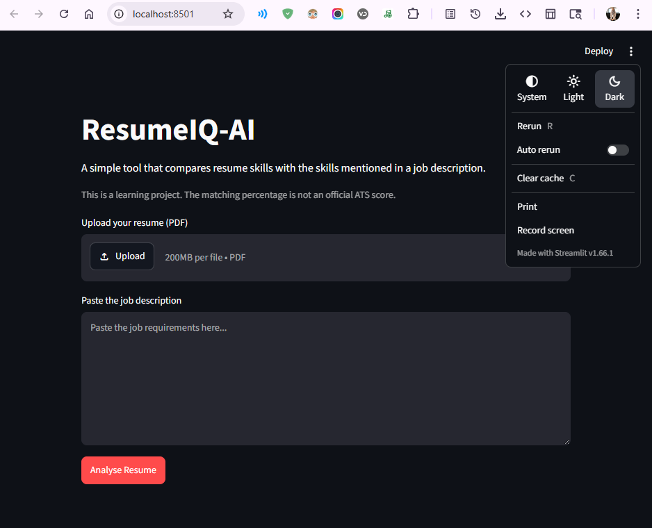
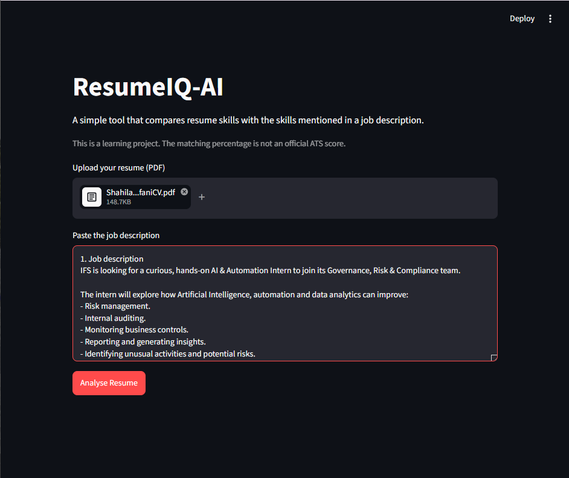
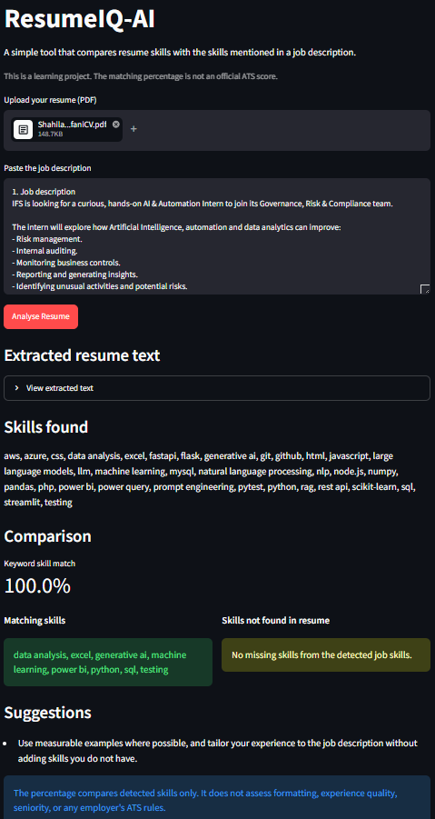

# ResumeIQ-AI

## 1. About the Project

This is one of my Python projects where I explored how AI-related techniques can help make the resume reviewing process a little easier.

I built a simple Streamlit application that reads a PDF resume, checks the skills mentioned in it, and compares them with the requirements in a job description.

The main idea was simple: upload a resume, paste a job description, and see which skills match and which ones might be missing.

I wanted to understand how we can use Python to extract information from documents and turn that information into something useful.

## 2. Why I Built This Project

When applying for internships and jobs, I realised that comparing a resume with every job description can take time.

Sometimes, a job advertisement mentions specific skills that applicants might overlook when reviewing their own CV.

That made me curious:

- How can we extract information directly from a PDF resume?
- How can we identify skills mentioned in a resume?
- How can we compare those skills with a job description?
- Can we highlight missing keywords to help someone improve their resume?
- How can we turn this idea into a simple application?

So, I decided to build ResumeIQ-AI to explore these concepts practically.

## 3. What I Built

Here's what I worked on:

- **PDF Resume Upload:** Added an option to upload a resume in PDF format.
- **Text Extraction:** Used PyMuPDF to extract readable text from PDF documents.
- **Skill Detection:** Created an editable skill dictionary to identify technical skills and keywords.
- **Job Description Analysis:** Added a text area where users can paste a job description.
- **Skill Comparison:** Compared the detected resume skills with the skills mentioned in the job description.
- **Matching Skills:** Displayed skills found in both the resume and job description.
- **Missing Skills:** Highlighted job-related skills that were not detected in the resume.
- **Keyword Match Percentage:** Calculated a basic percentage based on the detected matching skills.
- **Improvement Suggestions:** Provided simple suggestions based on the analysis results.

## 4. Technologies I Used

- **Python** – Main programming language.
- **Streamlit** – To build the interactive web application.
- **PyMuPDF** – To extract text from PDF resumes.
- **Regular Expressions (RegEx)** – To search for specific skill names and keywords in text.

## 5. Project Structure

Here's how I organised the project:

- `app.py` – Contains the Streamlit interface and application workflow.
- `resume_analyzer.py` – Handles PDF text analysis, skill detection, and comparison.
- `skills.py` – Contains the editable dictionary of skills used for matching.
- `requirements.txt` – Contains the required Python libraries.
- `screenshots/` – Contains screenshots of the application.

## 6. How to Install

First, make sure Python 3.10 or later is installed.

Clone the repository:

```bash
git clone YOUR_REPOSITORY_URL
cd ResumeIQ-AI
```

Create a virtual environment:

```bash
python -m venv .venv
```

Activate it:

**Windows:**
```bash
.venv\Scripts\activate
```

**macOS/Linux:**
```bash
source .venv/bin/activate
```

Install the required libraries:

```bash
pip install -r requirements.txt
```

## 7. How to Run

Start the Streamlit application:

```bash
streamlit run app.py
```

Open the local URL displayed in your terminal.

Upload your PDF resume, paste a job description, and start analysing!

## 8. How It Works

This project helped me explore how Python can extract and compare information from documents.

Here's the basic process:

**1. Uploading a Resume**

First, the user uploads a PDF resume through the Streamlit interface.

**2. Extracting PDF Text**

I used PyMuPDF to read the selectable text from the PDF pages.

This allows the application to access the resume content without manually typing everything.

**3. Detecting Skills**

I created a skill dictionary in `skills.py`.

Using regular expressions, the application searches the extracted resume text and job description for the skills listed in that dictionary.

**4. Comparing Skills**

After detecting the skills, the application compares two sets:

- Skills found in the resume.
- Skills mentioned in the job description.

From this comparison, it identifies matching skills and skills that were not detected in the resume.

**5. Calculating the Match Percentage**

The application calculates a basic keyword match percentage using the detected matching skills against the total detected job-description skills.

**6. Showing Results**

Finally, Streamlit displays the matching skills, missing skills, percentage, and basic improvement suggestions.

## 9. Screenshots

Here's a look at my ResumeIQ-AI application.

**Home Page**



**Resume Upload**



**Analysis Results**



## 10. What I Learned

This project helped me understand how to work with PDF documents and extract useful information using Python.

Here are some things I learned:

- How to build an interactive application using Streamlit.
- How to read PDF documents using PyMuPDF.
- How to extract and process text from documents.
- How regular expressions work and how to search for specific keywords.
- How to organise skills using Python dictionaries, lists, and sets.
- How to compare two collections of information.
- How to calculate a basic keyword matching percentage.
- How to validate user inputs and handle uploaded files.
- How to separate application logic into different Python files.

**The biggest thing I learned:** Even a simple keyword-matching system can help automate part of a manual process. I also understood that detecting a keyword doesn't necessarily mean understanding its actual meaning.

## 11. Limitations

There are still some limitations in this project:

- Scanned PDF resumes are not supported because OCR is not included.
- Skill detection depends on the predefined skill dictionary.
- Different names or variations of the same skill might not be recognised.
- The application doesn't understand the actual context or proficiency behind a skill.
- It doesn't evaluate work experience, project quality, or resume formatting.
- The matching percentage is not an official ATS score and does not predict whether an employer will shortlist an applicant.

This project is a basic resume analysis tool, not a replacement for professional recruitment or ATS systems.

## 12. Future Improvements

I'd like to take this project further by exploring:

- OCR support for scanned PDF resumes.
- Skill synonyms and alternative keyword recognition.
- More organised and editable skill categories.
- Semantic text comparison using NLP.
- AI-powered resume improvement suggestions.
- Job description analysis using Large Language Models (LLMs).
- More advanced resume-to-job matching techniques.

This would be a good opportunity to explore how NLP and Generative AI can make resume analysis more intelligent.

## 13. Credits

No external dataset or API is required for this project.

**Note:** Only upload resumes that you own or have permission to process. Resume documents may contain personal information, so handle them carefully.

---

*Building small ideas, exploring bigger possibilities. Still learning, still experimenting, and getting closer to the AI world. 🚀*
